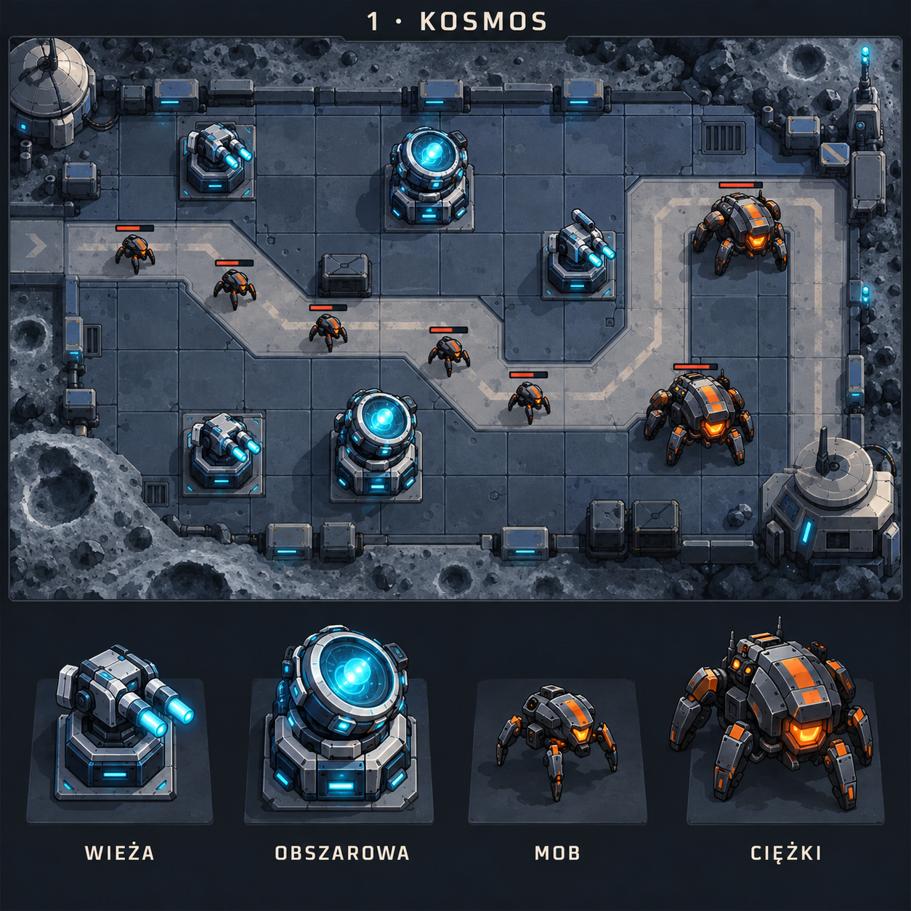
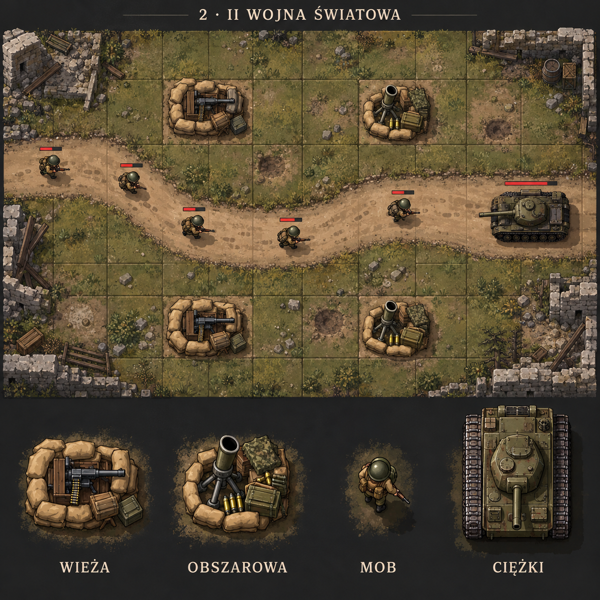
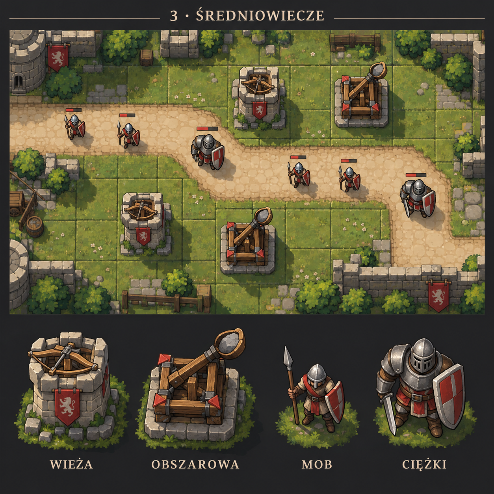
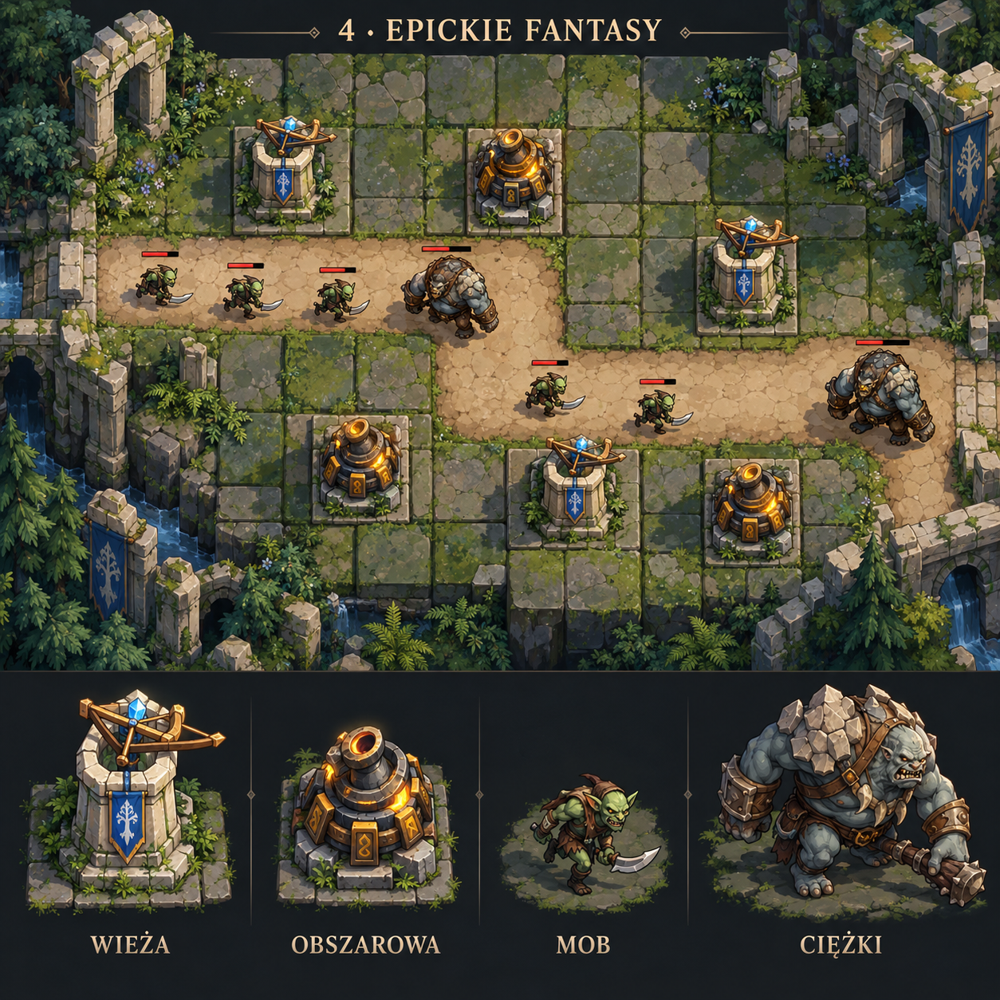
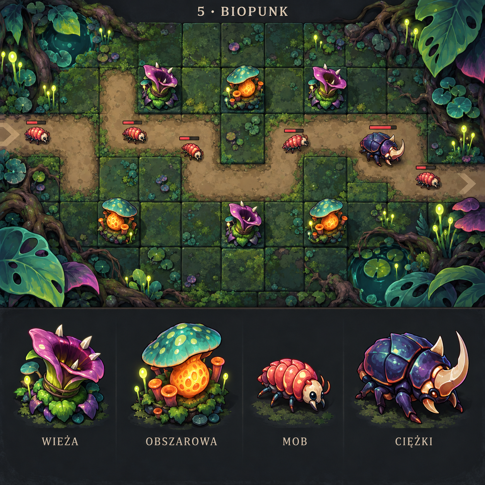

# Próbki kierunków graficznych

Wygenerowano wbudowanym image_gen. Plansze koncepcyjne do wyboru klimatu; jeszcze nie gotowe sprite’y do wdrożenia. Każda próbka: wieża podstawowa, wieża obszarowa, mob podstawowy i ciężki.

## 1 · KOSMOS



### Prompt

```text
Use case: stylized-concept.
Asset type: a square concept sheet for a 2D top-down tower defense game, a sample visual direction, not a poster.
Layout: one theme only. Uniform premium game art concept sheet on a tasteful dark neutral backing. Small exact title across the top. Upper 60 percent: a clearly overhead orthographic gameplay vignette with an axis-aligned square-tile board, several stationary towers placed on individual cells, a winding walkable lane between the towers and 6 small attacking units traversing the lane. Preserve a flat square grid as in a real 2D canvas game; no diamond isometric grid, no angled camera, no perspective horizon. Render towers and mobs with steep overhead three-quarter readable volumes showing top surfaces and a little front edge, consistent light from upper left. Vignette should look like practical game sprites on a playable arena, not cinematic scenery. Enemy health bars small and unobtrusive. Background textures quieter than units.
Lower 35 percent: four equally spaced enlarged isolated sprite studies with ample breathing room, in order: basic tower, area-damage tower, basic mob, heavy mob. The exact same four designs must appear on the board above, scaled down. Each tower occupies one cell. Heavy mob has a broad unmistakable silhouette; basic mob slender. Sprite art: polished hand-painted 2D stylized game assets, crisp contours, simplified bold forms that still read at 24–32 pixels, matte painted materials, limited surface detail, soft compact ground shadow. Aim at usable sprite designs, not simple geometric placeholders and not hyper-detailed concept illustrations. Do not put humanoid side-view portraits in the bottom strip. Bottom labels verbatim: "WIEŻA", "OBSZAROWA", "MOB", "CIĘŻKI". No HUD, no weapon stat descriptions, no watermark, no brand logos.
Title (verbatim): "1 · KOSMOS"
Theme and four unit designs: Deep space frontier defense on a lunar outpost. Blue gray modular titanium tiles with subtle seams, craters outside the rectangular arena, cyan energy details on friendly structures and orange markings on attackers. Basic tower: compact twin-barrel laser turret. Splash tower: heavy plasma mortar with luminous circular coil. Basic mob: small hostile mechanical walking drone. Heavy mob: armored six-legged assault mech. Cool navy, cyan, orange, restrained glow.
```

## 2 · II WOJNA ŚWIATOWA



### Prompt

```text
Use case: stylized-concept.
Asset type: a square concept sheet for a 2D top-down tower defense game, a sample visual direction, not a poster.
Layout: one theme only. Uniform premium game art concept sheet on a tasteful dark neutral backing. Small exact title across the top. Upper 60 percent: a clearly overhead orthographic gameplay vignette with an axis-aligned square-tile board, several stationary towers placed on individual cells, a winding walkable lane between the towers and 6 small attacking units traversing the lane. Preserve a flat square grid as in a real 2D canvas game; no diamond isometric grid, no angled camera, no perspective horizon. Render towers and mobs with steep overhead three-quarter readable volumes showing top surfaces and a little front edge, consistent light from upper left. Vignette should look like practical game sprites on a playable arena, not cinematic scenery. Enemy health bars small and unobtrusive. Background textures quieter than units.
Lower 35 percent: four equally spaced enlarged isolated sprite studies with ample breathing room, in order: basic tower, area-damage tower, basic mob, heavy mob. The exact same four designs must appear on the board above, scaled down. Each tower occupies one cell. Heavy mob has a broad unmistakable silhouette; basic mob slender. Sprite art: polished hand-painted 2D stylized game assets, crisp contours, simplified bold forms that still read at 24–32 pixels, matte painted materials, limited surface detail, soft compact ground shadow. Aim at usable sprite designs, not simple geometric placeholders and not hyper-detailed concept illustrations. Do not put humanoid side-view portraits in the bottom strip. Bottom labels verbatim: "WIEŻA", "OBSZAROWA", "MOB", "CIĘŻKI". No HUD, no weapon stat descriptions, no watermark, no brand logos.
Title (verbatim): "2 · II WOJNA ŚWIATOWA"
Theme and four unit designs: 1940s European battlefield, grounded historical military equipment, muted olive green, earth brown, warm sand and gunmetal. Basic tower: sandbagged stationary machine-gun nest with short broad barrel silhouette. Splash tower: squat artillery mortar emplacement with ammunition crates. Basic mob: helmeted infantry soldier with backpack seen from above. Heavy mob: compact tracked medium tank seen from above. Dirt and short grass tiles, footprints, small broken masonry at arena boundary. No flags, emblems, propaganda or insignia.
```

## 3 · ŚREDNIOWIECZE



### Prompt

```text
Use case: stylized-concept.
Asset type: a square concept sheet for a 2D top-down tower defense game, a sample visual direction, not a poster.
Layout: one theme only. Uniform premium game art concept sheet on a tasteful dark neutral backing. Small exact title across the top. Upper 60 percent: a clearly overhead orthographic gameplay vignette with an axis-aligned square-tile board, several stationary towers placed on individual cells, a winding walkable lane between the towers and 6 small attacking units traversing the lane. Preserve a flat square grid as in a real 2D canvas game; no diamond isometric grid, no angled camera, no perspective horizon. Render towers and mobs with steep overhead three-quarter readable volumes showing top surfaces and a little front edge, consistent light from upper left. Vignette should look like practical game sprites on a playable arena, not cinematic scenery. Enemy health bars small and unobtrusive. Background textures quieter than units.
Lower 35 percent: four equally spaced enlarged isolated sprite studies with ample breathing room, in order: basic tower, area-damage tower, basic mob, heavy mob. The exact same four designs must appear on the board above, scaled down. Each tower occupies one cell. Heavy mob has a broad unmistakable silhouette; basic mob slender. Sprite art: polished hand-painted 2D stylized game assets, crisp contours, simplified bold forms that still read at 24–32 pixels, matte painted materials, limited surface detail, soft compact ground shadow. Aim at usable sprite designs, not simple geometric placeholders and not hyper-detailed concept illustrations. Do not put humanoid side-view portraits in the bottom strip. Bottom labels verbatim: "WIEŻA", "OBSZAROWA", "MOB", "CIĘŻKI". No HUD, no weapon stat descriptions, no watermark, no brand logos.
Title (verbatim): "3 · ŚREDNIOWIECZE"
Theme and four unit designs: Medieval castle defense without magic. Warm beige limestone, chestnut wood, natural greens and muted red accents. Basic tower: small squat stone archer tower with a crossbow mounted on top. Splash tower: wooden catapult on a square stone foundation, clearly distinguishable wide throwing arm. Basic mob: light raider carrying shield and spear. Heavy mob: broad heavily armored knight with shield. Grass and worn cobblestone square tiles, low walls and bushes at arena edge. Charming grounded handcrafted storybook game art.
```

## 4 · EPICKIE FANTASY



### Prompt

```text
Use case: stylized-concept.
Asset type: a square concept sheet for a 2D top-down tower defense game, a sample visual direction, not a poster.
Layout: one theme only. Uniform premium game art concept sheet on a tasteful dark neutral backing. Small exact title across the top. Upper 60 percent: a clearly overhead orthographic gameplay vignette with an axis-aligned square-tile board, several stationary towers placed on individual cells, a winding walkable lane between the towers and 6 small attacking units traversing the lane. Preserve a flat square grid as in a real 2D canvas game; no diamond isometric grid, no angled camera, no perspective horizon. Render towers and mobs with steep overhead three-quarter readable volumes showing top surfaces and a little front edge, consistent light from upper left. Vignette should look like practical game sprites on a playable arena, not cinematic scenery. Enemy health bars small and unobtrusive. Background textures quieter than units.
Lower 35 percent: four equally spaced enlarged isolated sprite studies with ample breathing room, in order: basic tower, area-damage tower, basic mob, heavy mob. The exact same four designs must appear on the board above, scaled down. Each tower occupies one cell. Heavy mob has a broad unmistakable silhouette; basic mob slender. Sprite art: polished hand-painted 2D stylized game assets, crisp contours, simplified bold forms that still read at 24–32 pixels, matte painted materials, limited surface detail, soft compact ground shadow. Aim at usable sprite designs, not simple geometric placeholders and not hyper-detailed concept illustrations. Do not put humanoid side-view portraits in the bottom strip. Bottom labels verbatim: "WIEŻA", "OBSZAROWA", "MOB", "CIĘŻKI". No HUD, no weapon stat descriptions, no watermark, no brand logos.
Title (verbatim): "4 · EPICKIE FANTASY"
Theme and four unit designs: Original epic high-fantasy world with the atmosphere of ancient mountain kingdoms, elven craftsmanship and dark invading armies. Basic tower: pale stone guardian tower with graceful wood bow mechanism and a small blue rune. Splash tower: squat dwarven rune-forged siege cannon with bronze bands and glowing amber core. Basic mob: lean green-gray goblin raider with curved blade. Heavy mob: huge armored troll with rocklike shoulders. Moss-covered stone square tiles, ruined arches and ferns outside arena. Deep forest green, ivory, bronze, restrained blue and amber magic. Original designs with no named franchise characters or recognizable movie props.
```

## 5 · BIOPUNK



### Prompt

```text
Use case: stylized-concept.
Asset type: a square concept sheet for a 2D top-down tower defense game, a sample visual direction, not a poster.
Layout: one theme only. Uniform premium game art concept sheet on a tasteful dark neutral backing. Small exact title across the top. Upper 60 percent: a clearly overhead orthographic gameplay vignette with an axis-aligned square-tile board, several stationary towers placed on individual cells, a winding walkable lane between the towers and 6 small attacking units traversing the lane. Preserve a flat square grid as in a real 2D canvas game; no diamond isometric grid, no angled camera, no perspective horizon. Render towers and mobs with steep overhead three-quarter readable volumes showing top surfaces and a little front edge, consistent light from upper left. Vignette should look like practical game sprites on a playable arena, not cinematic scenery. Enemy health bars small and unobtrusive. Background textures quieter than units.
Lower 35 percent: four equally spaced enlarged isolated sprite studies with ample breathing room, in order: basic tower, area-damage tower, basic mob, heavy mob. The exact same four designs must appear on the board above, scaled down. Each tower occupies one cell. Heavy mob has a broad unmistakable silhouette; basic mob slender. Sprite art: polished hand-painted 2D stylized game assets, crisp contours, simplified bold forms that still read at 24–32 pixels, matte painted materials, limited surface detail, soft compact ground shadow. Aim at usable sprite designs, not simple geometric placeholders and not hyper-detailed concept illustrations. Do not put humanoid side-view portraits in the bottom strip. Bottom labels verbatim: "WIEŻA", "OBSZAROWA", "MOB", "CIĘŻKI". No HUD, no weapon stat descriptions, no watermark, no brand logos.
Title (verbatim): "5 · BIOPUNK"
Theme and four unit designs: An imaginative living-world tower defense inside a bioluminescent alien garden. Basic tower: living pitcher-plant turret launching thorns, broad purple petals and a compact mossy base. Splash tower: bulky bulbous mushroom spore mortar with an orange sac and teal cap. Basic mob: nimble beetle larva with bright coral shell. Heavy mob: chunky armored rhinoceros beetle with thick plates. Dark mossy square tiles, roots and giant leaves outside arena. Emerald, deep teal, plum, coral and small bioluminescent yellow-green accents. Friendly but strange organic science fantasy, readable and charming, not horror.
```

